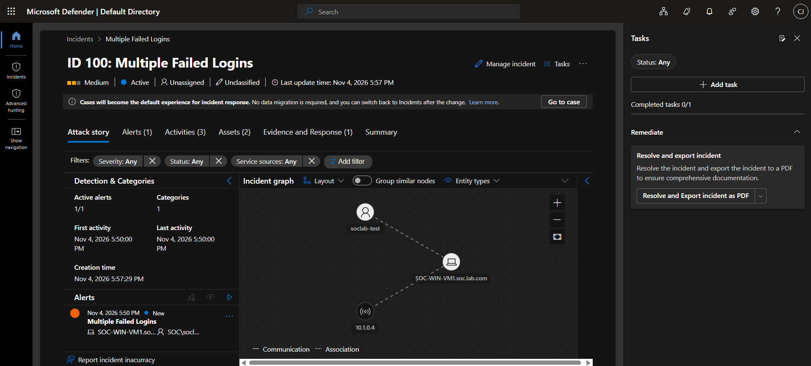
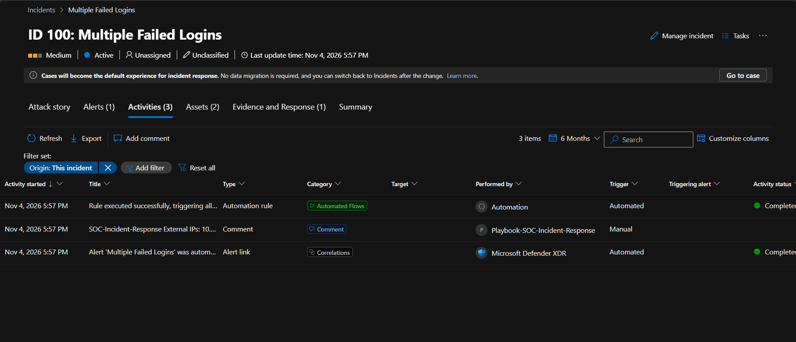
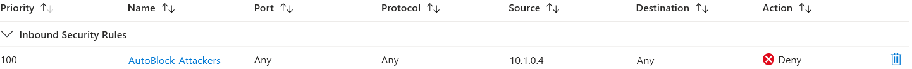
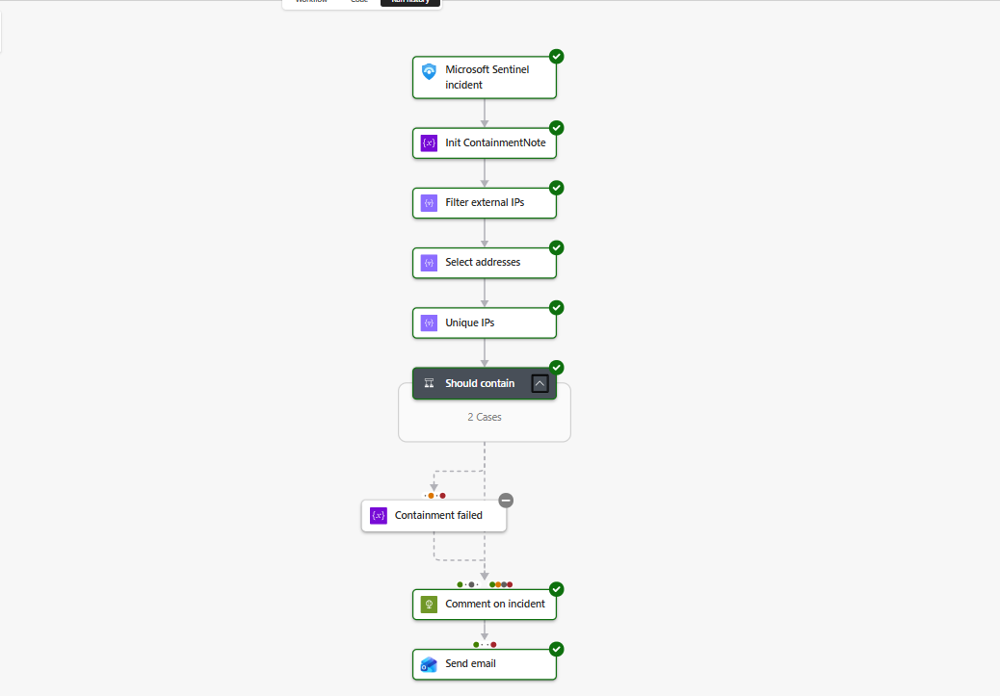

# Investigation: Failed Logons from the Attack VNet (Incident #100)

| | |
|---|---|
| **Incident** | #100, Multiple Failed Logins (repeat test of #98 and #99) |
| **Severity** | Medium |
| **Date** | 2026-11-04, 23:50 UTC |
| **Source** | `10.1.0.4` (`ATK-Kali-VM`, `Attack-VNET`) |
| **Target** | `SOC-WIN-VM1` (domain controller, `10.0.0.4`) |
| **MITRE ATT&CK** | T1110 Brute Force |
| **Disposition** | Benign positive: the detection was correct, and the activity was an authorized test. No successful logon. |
| **Response** | Automatic: source IP blocked on both Windows NSGs about 7 minutes after the first attempt |

## Summary

An authorized test sent six failed SMB logons from the Kali VM to the domain controller. Microsoft Sentinel raised
an incident, and the `SOC-Incident-Response` playbook blocked the source IP with no analyst involved. The same test
gave the same result in a separate session the night before (#99).

An earlier run (#98) also contained the IP, but the playbook started 90 minutes after the incident. That delay is
unexplained, so these results show the automation working in two consecutive runs, not a guaranteed response time.

This was a controlled test in an isolated lab: a short burst against a made-up account, sent from a known VM.

## The Test

Run from `ATK-Kali-VM`:

```bash
for i in 1 2 3 4 5 6; do smbclient -L //10.0.0.4 -U 'SOC\soclab-test%WrongPassword1' >/dev/null 2>&1; done
```

Before the test, TCP port 445 on the domain controller was reachable from Kali.

## Detection

[Multiple Failed Logins](../detections/multiple-failed-logins.kql) runs every 5 minutes over the last 5 minutes:

```kql
SecurityEvent
| where EventID == 4625
| summarize FailedAttempts=count() by Account, Computer, IpAddress, bin(TimeGenerated, 5m)
| where FailedAttempts >= 5
```

Its entity mappings put the account, host and IP on the incident. The playbook reads the IP entity to decide what
to block.



*Incident #100 in the Defender portal. The portal shows local time (UTC-6), so 5:50 PM is 23:50 UTC.*

## Investigation

Findings for the six events, all from `SecurityEvent` on `SOC-WIN-VM1.soc.lab.com`:

| Field | Value | What it means |
|---|---|---|
| Event ID | 4625 | Failed logon |
| Logon type | 3 | Network logon, consistent with SMB |
| Authentication | `NtLmSsp` | NTLM, not Kerberos |
| Workstation | `KALI` | The name the client reported, matching the source VM |
| Account | `SOC\soclab-test` | The only account targeted |
| Status / sub-status | `0xC000006D` / `0xC0000064` | Logon failed because **the username does not exist** |
| Timing | 6 attempts in 0.32 seconds | Scripted, not a person typing |

**Was anything compromised?** The available logs show no sign of it. Over the 7-day query window, the only events
with `10.1.0.4` as the source IP or `KALI` as the workstation name were 24 failed logons (event 4625), all from these
tests. There were no successful logons (event 4624). The targeted account also does not exist, so these attempts
could not have succeeded.

```kql
SecurityEvent
| where IpAddress == "10.1.0.4" or WorkstationName =~ "KALI"
| summarize Count=count(), First=min(TimeGenerated), Last=max(TimeGenerated) by EventID, Activity
```

## Response

The automation rule runs the playbook on every new incident. For this incident the playbook:

1. Took the IP entities and removed protected ranges (the SOC subnet `10.0.`, loopback and blank values). `10.1.0.4`
   remained.
2. Confirmed the incident title is on its containment list.
3. Wrote `AutoBlock-Attackers` (priority 100, deny all inbound from `10.1.0.4`) to `SOC-WIN-VM1-nsg` and
   `SOC-WIN10-VM-nsg`.
4. Commented on the incident:

   > Blocked inbound traffic from 10.1.0.4 on SOC-WIN-VM1-nsg, SOC-WIN10-VM-nsg (rule AutoBlock-Attackers).



*The incident's activity log shows the automation rule running and the playbook's comment, all at 5:57 PM local time.*

**Verification:** both NSGs showed the rule, and port 445 went from open to closed or filtered when tested from Kali.
The logon attempts themselves were not repeated after the block.



*The rule the playbook created on `SOC-WIN-VM1-nsg`.*

**The run history shows "Failed", but containment worked.** Two steps report a failure:

| Step | Result | Why |
|---|---|---|
| `Get_block_rule` | Failed (harmless) | The block rule doesn't exist yet on a first block. The playbook expects this and continues. |
| `Send_email` | Failed (real) | The Outlook.com connection had not been authorized yet, so **no email was sent during this run**. |

**Email was fixed afterwards.** The connection was authorized on 2026-11-06, and this run was resubmitted at 21:56 UTC.
Every step passed and the email arrived. That run replayed #100's original trigger, but a later live port scan
test (incident #103) also blocked Kali and passed the email step in a single run.



*The resubmitted run from 2026-11-06, not the original run. The grey "Containment failed" branch is correctly skipped.*

## Timeline

Elapsed time is measured from the first failed logon in each burst. All times are UTC.

| Step | #100 (Nov 4, 23:50) | #99 (Nov 4, 02:13) | #98 (Nov 3, 03:50) |
|---|---|---|---|
| First failed logon | 23:50:27 | 02:13:21 | 03:50:43 |
| Events ingested | 23:55:04 (+4:37) | 02:14:04 (+0:43) | 03:54:59 (+4:15) |
| Alert created | 23:57:09 (+6:42) | 02:22:03 (+8:42) | 03:56:30 (+5:46) |
| Incident created | 23:57:29 (+7:01) | 02:22:09 (+8:48) | 03:56:38 (+5:54) |
| Playbook started | 23:57:36 (+7:08) | 02:22:17 (+8:56) | **05:26:42 (+1:35:58)** |
| Block rule written | 23:57:38 (+7:11) | 02:22:19 (+8:58) | 05:26:44 (+1:36:01) |

What the numbers show:

- **The playbook is fast.** In all three runs it wrote the block within about 3 seconds of starting and finished in
  under 7 seconds.
- **Most of the time is spent before the incident exists.** Ingestion and rule scheduling took 5 to 9 minutes and
  varied between runs. The rule could fire about 2 minutes after ingestion (#100) or about 8 minutes after (#99).

## Open Questions and Limitations

**Not yet explained**

- **The 90-minute delay on #98.** The incident was created at 03:56:38, but the playbook didn't start until 05:26:42.
  Manual attempts to run it that night returned gateway timeouts, so that run may have come from a queued manual
  request instead of the automation rule. Sentinel's health log (`SentinelHealth`) returned no automation records
  for it, so the cause is unknown. Two clean runs followed.
- **The wait before #99's alert.** The events were ingested at 02:14:04, but the alert didn't appear until 02:22:03.

**Detection gaps**

- **Late logs can be missed.** The first burst of the #98 session, at 03:32:21, was not ingested until 03:53:30, by
  which time it was outside the rule's 5-minute lookback. It met the threshold but never produced an alert. Only a
  second burst at 03:50 did.
- **Attempts can be split across time bins.** The rule counts within fixed 5-minute bins, so three failures at 12:04
  and three at 12:06 would not reach the threshold of 5. A slow attack also stays below it.
- **A real attack would look different.** This test proves the pipeline works, not how the rule performs against
  realistic or stealthy activity.

**Containment gaps**

- **Repeat activity may not trigger a new block.** For 5 hours, Sentinel adds alerts with the same account, host and
  IP to the open incident. The playbook only runs when an incident is created, so if a block were removed during that
  window, a repeat attack would not be blocked again.
- **Blocks never expire.** Each one stays until someone removes it with
  [`Clear-AutoBlocks.ps1`](../scripts/Clear-AutoBlocks.ps1).
- **Rule names matter.** The playbook matches the incident title, so renaming a rule would silently turn off its
  containment.
- **IPv6 is not handled.** IPv6 addresses are filtered out and never blocked.
- **The "External IPs" label is inaccurate here.** `10.1.0.4` is a private address in the peered VNet. The playbook
  really means "outside the SOC subnet".

## Next Steps

1. Find the cause of the #98 delay by getting automation records into `SentinelHealth` and watching for a repeat.
2. Make the rule tolerate late logs, for example by using a longer lookback and filtering on `ingestion_time()`.
3. Add an expiry to automatic blocks.

## Reproducing This

1. Start the lab with `./scripts/Start-Lab.ps1 -IncludeKali`, then wait for logs to reach Sentinel
   (`./scripts/Test-LabHealth.ps1`).
2. Run the test command above from Kali through Bastion.
3. Expect an incident and a block in about 7 to 10 minutes, based on the two most recent runs.
4. Remove the block with `./scripts/Clear-AutoBlocks.ps1`, then run `./scripts/Stop-Lab.ps1`.
